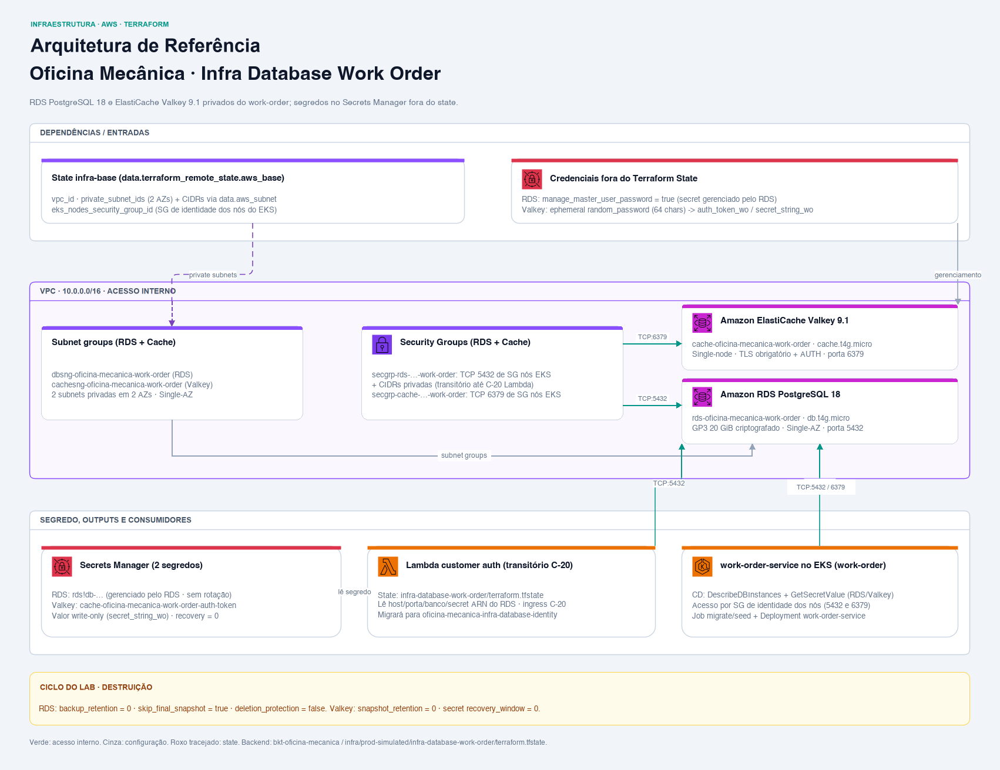

<div align="center">

# 🐘 Oficina Mecânica — Dados do Work Order: RDS PostgreSQL & ElastiCache for Valkey (IaC)

**Provisionamento automatizado do banco relacional Amazon RDS PostgreSQL 18 e do cache Amazon ElastiCache for Valkey 9.1 exclusivos do contexto `work-order` na AWS com Terraform.**


</div>

## 📋 Sobre

Este repositório (`oficina-mecanica-infra-database-work-order`, renomeado a partir de `oficina-mecanica-infra-database`) contém o código de **Infraestrutura como Código (IaC)** responsável pelo provisionamento dos recursos de dados exclusivos do microsserviço **[Work Order](https://github.com/FIAP-15SOAT/oficina-mecanica-work-order-service)** da solução **Oficina Mecânica**: o banco relacional gerenciado **Amazon RDS (PostgreSQL 18)** e o cache gerenciado **Amazon ElastiCache for Valkey 9.1**.

Seguindo o padrão de **um repositório de dados por serviço** ([ADR 0004](docs/adr/0004-um-repositorio-de-dados-por-servico.md)), este repositório também serve de **template** para os repositórios de dados dos demais microsserviços (`oficina-mecanica-infra-database-identity`, `oficina-mecanica-infra-database-billing` e `oficina-mecanica-infra-database-inventory`), que copiam esta estrutura alterando apenas a variável `service_context` e a chave do backend S3.

Faz parte do ecossistema de serviços e infraestrutura da pós-graduação em Arquitetura de Software da FIAP (turma 15SOAT). O [serviço Work Order](https://github.com/FIAP-15SOAT/oficina-mecanica-work-order-service) é a entrada central da documentação da solução.

---

### 🏗️ Recursos Provisionados

1. **Amazon RDS PostgreSQL 18 (`rds.tf` e `secrets.tf`)**:
   - Instância gerenciada `rds-oficina-mecanica-work-order` (`rds-${var.project_name}-${var.service_context}`), engine `postgres` na major **18** (`db_engine_version = "18"`, com `auto_minor_version_upgrade = true`), **Single-AZ** (`multi_az = false`) e classe **`db.t4g.micro`**.
   - Armazenamento **20 GiB GP3** criptografado em repouso (`storage_encrypted = true`), sem margem de crescimento automático nos defaults (`db_max_allocated_storage = 20`).
   - Acesso exclusivamente privado (`publicly_accessible = false`) no subnet group `dbsng-oficina-mecanica-work-order` nas subnets privadas da VPC; porta `5432`, banco inicial e master username `techchallenge`.
   - Master password gerenciada pelo próprio RDS no AWS Secrets Manager (`manage_master_user_password = true`) com rotação automática desabilitada (`aws_secretsmanager_secret_rotation` com `rotation_enabled = false`, ver [ADR 0003](docs/adr/0003-master-password-gerenciada-pelo-rds.md)).
   - Sem retenção de backups automáticos (`backup_retention_period = 0`), `skip_final_snapshot = true` e `deletion_protection = false` para recriação rápida a cada sessão do AWS Academy Learner Lab.

2. **Amazon ElastiCache for Valkey 9.1 e Secret Write-Only (`elasticache.tf`)**:
   - Replication group `cache-oficina-mecanica-work-order` (`cache-${var.project_name}-${var.service_context}`) com `engine = "valkey"`, `engine_version = "9.1"`, 1 nó `cache.t4g.micro` (`num_cache_clusters = 1`, `automatic_failover_enabled = false`), porta `6379`, no subnet group `cachesng-oficina-mecanica-work-order` nas subnets privadas.
   - Criptografia em trânsito obrigatória (`transit_encryption_enabled = true`, `transit_encryption_mode = "required"`), criptografia em repouso (`at_rest_encryption_enabled = true`), `apply_immediately = true` e sem snapshots (`snapshot_retention_limit = 0`).
   - **Senha fora do state ([ADR 0005](docs/adr/0005-elasticache-com-tls-e-senha-fora-do-state.md))**: um recurso efêmero `ephemeral "aws_secretsmanager_random_password"` gera uma senha de 64 caracteres sem pontuação durante o apply; o valor é aplicado ao ElastiCache por `auth_token_wo` (`auth_token_wo_version = 1`) e gravado no secret `cache-oficina-mecanica-work-order-auth-token` (`recovery_window_in_days = 0`) por `secret_string_wo` (`secret_string_wo_version = 1`). Nenhuma senha ou token entra no `terraform.tfstate` nem aparece no `plan`.

3. **Security Groups restritos aos nós do EKS (`security_group.tf`)**:
   - `secgrp-rds-oficina-mecanica-work-order`: libera entrada TCP `5432` a partir do Security Group de identidade dos nós do EKS (`eks_nodes_security_group_id`, lido do state da `infra-base`) e, **provisoriamente até a C-20**, a partir dos CIDRs das subnets privadas (obtidos via `data "aws_subnet"` sobre `private_subnet_ids`) para que a [Lambda `customer-auth`](https://github.com/FIAP-15SOAT/oficina-mecanica-lambda-customer-auth) continue autenticando clientes enquanto não migra para o `identity-service`. Sem regras de saída (`egress`).
   - `secgrp-cache-oficina-mecanica-work-order`: libera entrada TCP `6379` exclusivamente a partir de `eks_nodes_security_group_id`, sem regra por CIDR e sem regras de saída (`egress`).



### Credenciais, consumidores e migrações

- O [serviço Work Order](https://github.com/FIAP-15SOAT/oficina-mecanica-work-order-service) descobre a instância RDS pelo identificador fixo `rds-oficina-mecanica-work-order` (`RDS_INSTANCE_IDENTIFIER`) e o cache pelo identificador fixo `cache-oficina-mecanica-work-order` e pelo secret `cache-oficina-mecanica-work-order-auth-token` durante o CD, materializando os Secrets Kubernetes no namespace `work-order` sem ler o state deste repositório.
- O job `db-migrate` do **CD do Work Order** executa `prisma migrate deploy` dentro do EKS antes de `app-deploy`. Este Terraform provisiona o RDS e o ElastiCache, mas não cria tabelas nem executa migrations.
- Até a C-20, a [Lambda de autenticação de clientes](https://github.com/FIAP-15SOAT/oficina-mecanica-lambda-customer-auth) lê `db_host`, `db_port`, `db_name` e `db_credentials_secret_arn` pelo remote state na chave `infra/prod-simulated/infra-database-work-order/terraform.tfstate`.

---

## 📁 Estrutura do Repositório

```text
.
├── .github/
│   └── workflows/
│       ├── cd.yml  # Apply na main, controlado por ENABLE_DEPLOY ou disparo manual
│       └── ci.yml  # Valida Terraform e abre PR; plan condicionado a credenciais
├── docs/
│   ├── adr/
│   │   ├── 0001-banco-gerenciado-amazon-rds.md
│   │   ├── 0002-credencial-via-variavel-terraform-sensivel.md
│   │   ├── 0003-master-password-gerenciada-pelo-rds.md
│   │   ├── 0004-um-repositorio-de-dados-por-servico.md
│   │   └── 0005-elasticache-com-tls-e-senha-fora-do-state.md
│   ├── diagrams/
│   │   ├── cd-workflow.png  # Job e steps do workflow de CD
│   │   ├── ci-workflow.png  # Jobs e steps do workflow de CI
│   │   └── infrastructure.png  # Arquitetura do RDS, ElastiCache, SGs e secrets
│   ├── ci-cd.md  # Jobs, steps, conditions e diagramas de CI/CD
│   └── runbook.md  # Subida, verificação pós-apply, derrubada e falhas conhecidas
├── terraform/
│   ├── .terraform.lock.hcl  # Versões e checksums dos providers (aws >= 6.62.0)
│   ├── backend.tf  # Backend S3 e lock nativo na chave infra-database-work-order
│   ├── elasticache.tf  # ElastiCache for Valkey 9.1, senha efêmera e secret write-only
│   ├── locals.tf  # Convenções de nomes derivadas de project_name e service_context
│   ├── outputs.tf  # Outputs escalares do RDS e do ElastiCache (sem credenciais)
│   ├── providers.tf  # Provider AWS e leitura do remote state da infra-base
│   ├── rds.tf  # RDS PostgreSQL 18 e DB subnet group
│   ├── secrets.tf  # Configuração explícita de rotação desabilitada do Secret do RDS
│   ├── security_group.tf  # Security Groups do RDS e do ElastiCache
│   ├── terraform.tfvars.example  # Referência para configurar o ambiente
│   └── variables.tf  # Variáveis de entrada (incluindo service_context)
├── .gitignore  # Arquivos locais ignorados
└── README.md  # Entrada do componente e guia local
```

---

## 💾 Estado Remoto (Remote State)

O estado do Terraform é armazenado remotamente no Amazon S3, com criptografia
e lock nativo (`use_lockfile = true`):

- **Bucket**: o valor da variável de Actions da organização `TF_STATE_BUCKET`, passado no `terraform init` por `-backend-config`
- **Chave (Key)**: `infra/prod-simulated/infra-database-work-order/terraform.tfstate`
- **Região**: `us-east-1`

O bucket deve existir, e a identidade AWS precisa acessar state e lockfile.
O state da `infra-base` é lido no bucket de `aws_base_state_bucket`, que os workflows
preenchem com `TF_STATE_BUCKET`.

### 🔗 Integração com `oficina-mecanica-infra-base`

Este repositório consome `vpc_id`, `private_subnet_ids` e `eks_nodes_security_group_id` (`secgrp-eks-nodes-oficina-mecanica`) provisionados pela
[infra-base](https://github.com/FIAP-15SOAT/oficina-mecanica-infra-base) via
**Remote State**. Aplique a `infra-base` antes deste repositório:

```hcl
data "terraform_remote_state" "aws_base" {
  backend = "s3"

  config = {
    bucket = var.aws_base_state_bucket
    key    = var.aws_base_state_key
    region = var.aws_base_state_region
  }
}
```

Os defaults são a key `infra/prod-simulated/infra-base/terraform.tfstate` e a região `us-east-1`.
Como o Security Group de identidade dos nós do EKS nasce na `infra-base`, este repositório pode subir em paralelo com o `oficina-mecanica-infra-k8s`.

---

## 🔐 Configuração de Secrets e Variáveis no GitHub Actions

Para a execução automatizada dos pipelines de CI e CD, configure os seguintes parâmetros nas configurações da organização ou do repositório:

### Secrets do GitHub (`Settings > Secrets and variables > Actions > Secrets`)

| Secret | Nível | Descrição |
|---|---|---|
| `AWS_ACCESS_KEY_ID` | Organização | Access Key temporária do AWS Academy / Learner Lab |
| `AWS_SECRET_ACCESS_KEY` | Organização | Secret Access Key do AWS Academy |
| `AWS_SESSION_TOKEN` | Organização | Token temporário de sessão do AWS Academy |
| `BOT_PRIVATE_KEY` | Organização | Chave privada (`.pem`) do GitHub App para abertura automática de PRs |

### Variáveis do GitHub (`Settings > Secrets and variables > Actions > Variables`)

| Variável | Nível | Valor Padrão | Descrição |
|---|---|---|---|
| `BOT_APP_ID` | Organização | — | ID numérico do GitHub App configurado na Organização |
| `TF_STATE_BUCKET` | Organização | — | Nome do bucket S3 de state; vai ao `terraform init` por `-backend-config` e a `TF_VAR_aws_base_state_bucket` |
| `ENABLE_DEPLOY` | Repositório | `true` / `false` | Habilita a execução automática do job `Terraform Database` no workflow de CD ao fazer push na `main` |

O disparo manual do CD também precisa selecionar `main`. Consulte [CI/CD](docs/ci-cd.md) para as conditions e steps completos e o [Runbook](docs/runbook.md) para procedimentos operacionais.

---

## ⚙️ Variáveis e Saídas

### Principais Variáveis de Entrada

| Variável | Tipo | Default | Descrição | Uso |
| --- | --- | --- | --- | --- |
| `aws_region` | `string` | `us-east-1` | Região dos recursos | Configura o provider AWS usado para provisionar RDS, ElastiCache, Security Groups e secrets. |
| `project_name` | `string` | `oficina-mecanica` | Prefixo do projeto | Compõe os nomes dos recursos em `locals.tf` e a tag `Project`. |
| `environment` | `string` | `prod-simulated` | Tag `Environment` | Identifica o ambiente nas tags dos recursos via `default_tags`. |
| `service_context` | `string` | `work-order` | Identificador do bounded context | Única variável de contexto: deriva em `locals.tf` os nomes `rds-`, `dbsng-`, `secgrp-rds-`, `cache-`, `cachesng-`, `secgrp-cache-` e `cache-...-auth-token`. |
| `aws_base_state_bucket` | `string` | — | Bucket do state da `infra-base` | Preenchida nos workflows por `TF_VAR_aws_base_state_bucket` a partir de `TF_STATE_BUCKET`. |
| `aws_base_state_key` | `string` | `infra/prod-simulated/infra-base/terraform.tfstate` | Key do state da `infra-base` | Seleciona o state que fornece `vpc_id`, `private_subnet_ids` e `eks_nodes_security_group_id`. |
| `aws_base_state_region` | `string` | `us-east-1` | Região do state da `infra-base` | Configura a região do bucket S3 na leitura do remote state. |
| `db_engine_version` | `string` | `18` | Versão major do PostgreSQL | Preenche `engine_version` da instância RDS PostgreSQL. |
| `db_instance_class` | `string` | `db.t4g.micro` | Classe da instância RDS | Define a capacidade de CPU e memória da instância RDS. |
| `db_allocated_storage` | `number` | `20` | Armazenamento inicial (GiB) | Define a capacidade inicial do volume `gp3` criptografado do RDS. |
| `db_max_allocated_storage` | `number` | `20` | Teto de armazenamento (GiB) | Igual ao inicial para desabilitar autoscaling de disco no laboratório. |
| `db_name` | `string` | `techchallenge` | Nome inicial do banco | Cria o banco inicial no RDS e fornece o output `db_name`. |
| `db_username` | `string` | `techchallenge` | Master username do RDS | Define o usuário mestre do RDS cuja senha é gerenciada no Secrets Manager. |
| `db_port` | `number` | `5432` | Porta do PostgreSQL | Configura a porta da instância RDS e as regras de entrada 5432 do `secgrp_rds`. |
| `multi_az` | `bool` | `false` | Habilita Multi-AZ | Mantém a instância RDS em Single-AZ para economia de créditos no laboratório. |
| `backup_retention_period` | `number` | `0` | Retenção de backups (dias) | `0` desabilita backups automatizados no laboratório. |
| `skip_final_snapshot` | `bool` | `true` | Pula snapshot final no destroy | Permite destruir a instância RDS sem gerar snapshot final. |

---

### Saídas Exportadas (Outputs)

Nenhum output expõe senha, token ou URL de conexão. O CD do `work-order` descobre RDS, ElastiCache e secrets diretamente na AWS pelos identificadores fixos; até a C-20, a Lambda `customer-auth` lê `db_host`, `db_port`, `db_name` e `db_credentials_secret_arn` deste state.

| Output | Descrição | Exemplo | Uso |
| --- | --- | --- | --- |
| `db_instance_id` | Identificador da instância RDS | `rds-oficina-mecanica-work-order` | Localizar a instância RDS no console e na AWS CLI. |
| `db_instance_arn` | ARN da instância RDS | — | Referenciar a instância RDS em consultas e auditorias. |
| `db_endpoint` | Host e porta combinados do RDS | `rds-oficina-mecanica-work-order.xxxx.us-east-1.rds.amazonaws.com:5432` | Referência operacional `host:porta` da instância PostgreSQL. |
| `db_host` | Endereço DNS do host do RDS | `rds-oficina-mecanica-work-order.xxxx.us-east-1.rds.amazonaws.com` | Preenche `DATABASE_HOST` da Lambda `customer-auth` via remote state até a C-20. |
| `db_address` | Alias para `db_host` | `rds-oficina-mecanica-work-order.xxxx.us-east-1.rds.amazonaws.com` | Mantido por compatibilidade de contrato com os outputs anteriores. |
| `db_port` | Porta do PostgreSQL | `5432` | Preenche `DATABASE_PORT` da Lambda via remote state até a C-20. |
| `db_name` | Nome inicial do banco | `techchallenge` | Preenche `DATABASE_NAME` da Lambda via remote state até a C-20. |
| `db_security_group_id` | ID do Security Group do RDS | `sg-0123456789abcdef0` | Inspecionar as regras de entrada do RDS (`secgrp-rds-oficina-mecanica-work-order`). |
| `db_credentials_secret_arn` | ARN do Secret gerenciado pelo RDS | — | Preenche `DATABASE_SECRET_ID` da Lambda via remote state até a C-20. |
| `cache_primary_endpoint` | Endpoint primário do ElastiCache for Valkey | `master.cache-oficina-mecanica-work-order.xxxx.use1.cache.amazonaws.com` | Endereço DNS primário para conexões `rediss://` ao Valkey. |
| `cache_port` | Porta do ElastiCache for Valkey | `6379` | Porta TCP/TLS do replication group Valkey. |
| `cache_auth_token_secret_name` | Nome do Secret com o auth token do cache | `cache-oficina-mecanica-work-order-auth-token` | Identificador do Secret lido pelo CD do serviço para montar `REDIS_URL`. |
| `cache_security_group_id` | ID do Security Group do ElastiCache | `sg-0fedcba9876543210` | Inspecionar as regras de entrada do cache (`secgrp-cache-oficina-mecanica-work-order`). |

---

## 🚀 Como Executar Localmente

### Pré-requisitos

- **Terraform ≥ 1.11.0** e **AWS provider ≥ 6.62.0 e < 7.0.0** (necessários para `ephemeral` e argumentos write-only `auth_token_wo` e `secret_string_wo`).
- **AWS CLI v2** configurada com as credenciais temporárias da sessão ativa do AWS Academy Learner Lab.
- `oficina-mecanica-infra-base` previamente aplicada na mesma sessão (exportando `vpc_id`, `private_subnet_ids` e `eks_nodes_security_group_id`).

### Passos para Inicialização e Deploy

Na raiz do repositório, com sessão AWS ativa:

```bash
# 1. Acessar o diretório da configuração Terraform
cd terraform

# 2. Definir o bucket S3 de state da sessão atual do Learner Lab
export TF_STATE_BUCKET=<nome-do-bucket>

# 3. Exportar a variável consumida pelo data source do remote state da infra-base
export TF_VAR_aws_base_state_bucket="$TF_STATE_BUCKET"

# 4. Inicializar os providers e o backend remoto na chave infra-database-work-order
terraform init -reconfigure -backend-config="bucket=$TF_STATE_BUCKET"

# 5. Verificar a formatação dos arquivos HCL sem modificá-los
terraform fmt -check -recursive

# 6. Validar a sintaxe e a consistência da configuração com os schemas dos providers
terraform validate

# 7. Visualizar o plano de execução (os argumentos write-only não exibem senhas)
terraform plan

# 8. Aplicar a infraestrutura (RDS PostgreSQL 18, ElastiCache Valkey 9.1, SGs e secrets)
terraform apply

# 9. Consultar os outputs escalares exportados pela stack
terraform output
```

### Validação estática, sem sessão AWS ativa

Na pasta `terraform/`, sem conectar ao backend S3 ou à conta AWS:

```bash
# Verificar a formatação dos arquivos Terraform
terraform fmt -check -recursive

# Instalar os providers sem inicializar o backend remoto
terraform init -backend=false

# Validar a configuração contra os schemas dos providers instalados
terraform validate
```

### Encerramento do laboratório

- Remova primeiro as Lambdas e os workloads dependentes.
- Destrua este repositório antes de destruir `oficina-mecanica-infra-base`:

```bash
# Visualizar o plano de destruição dos recursos de dados do work-order
terraform plan -destroy

# Destruir o RDS, o ElastiCache, os Security Groups, os subnet groups e o secret
terraform destroy
```

Consulte o [Runbook operacional](docs/runbook.md) para os comandos de verificação pós-apply (`terraform state pull` sem senha e testes `psql` / `valkey-cli --tls` a partir de um pod no EKS) e diagnóstico de falhas conhecidas.

---

## 🔄 Pipelines de CI/CD

O repositório conta com dois workflows automatizados via GitHub Actions:

- **CI (`ci.yml`)**: dispara em push em `feature/**` e `fix/**`; executa `Terraform Validation` (`fmt -check`, `init -backend=false`, `validate` e `plan` tolerante à indisponibilidade de credenciais do Lab) e `Open Pull Request` via GitHub App.
- **CD (`cd.yml`)**: dispara em push na `main` (com `ENABLE_DEPLOY == 'true'`) ou `workflow_dispatch`; executa o job `Terraform Database` (`init`, `validate`, `plan` e `apply`) no environment `production`.

A [documentação de CI/CD](docs/ci-cd.md) detalha cada job, step, condição e diagrama.

---

## 📐 Decisões Arquiteturais

- [ADR 0001 — Banco de dados relacional como serviço gerenciado (Amazon RDS PostgreSQL 18)](docs/adr/0001-banco-gerenciado-amazon-rds.md)
- [ADR 0002 — Senha do banco por variável Terraform sensível e publicação no Secrets Manager (substituído)](docs/adr/0002-credencial-via-variavel-terraform-sensivel.md)
- [ADR 0003 — Master password gerenciada pelo Amazon RDS](docs/adr/0003-master-password-gerenciada-pelo-rds.md)
- [ADR 0004 — Um repositório de dados por serviço](docs/adr/0004-um-repositorio-de-dados-por-servico.md)
- [ADR 0005 — ElastiCache for Valkey com TLS e senha fora do state](docs/adr/0005-elasticache-com-tls-e-senha-fora-do-state.md)
